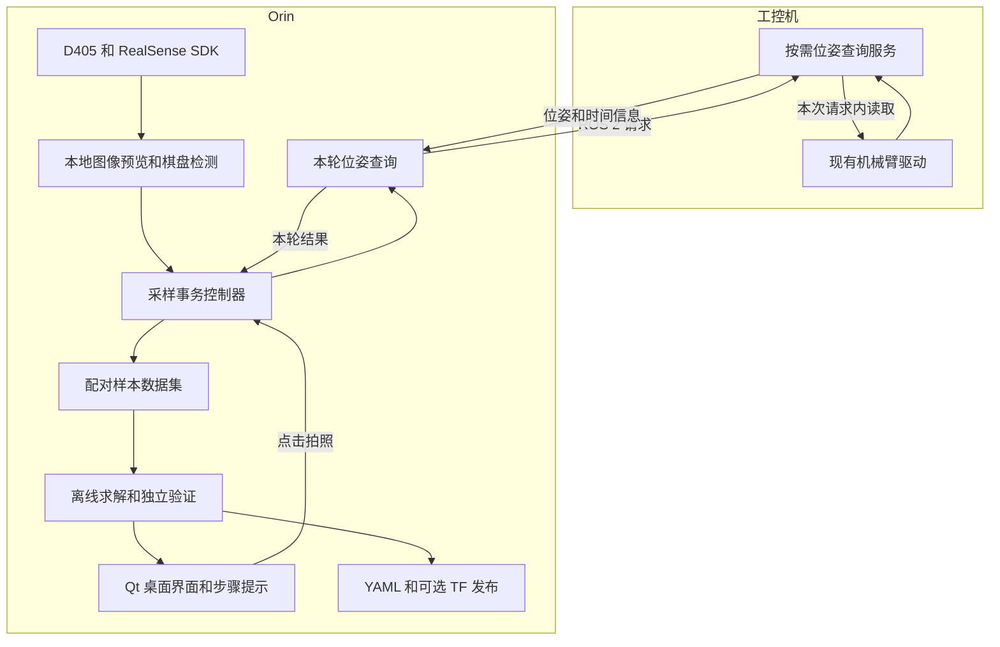

# D405 眼在手上标定开发方案

面向开发 agent 的实施任务书，版本 1.1，日期 2026-11-05。

实现一套运行在 NVIDIA Orin 上的 Python 手眼标定工具：通过 RealSense SDK 直连 D405，使用 OpenCV 求解，通过 ROS 2 接收工控机的机械臂末端位姿，并提供原生桌面界面、分步操作提示、离线重算和验证报告。机械臂位姿仅在拍照事务内按需读取，默认每张照片读取一次。

第一版按眼在手上实现：D405 刚性安装在机械臂末端，标定板固定在相对机械臂基座不动的位置。相机安装方式尚未明确确认，现场开始采样前应确认这一点。若实际相机固定在外部，应增加独立的眼在手外模式及对应测试，不能直接沿用本方案的输入方向。

## 目标和已知条件

| 项目 | 约定 |
| --- | --- |
| 相机 | RealSense D405，由 Orin 本地 USB 连接 |
| 机械臂接口 | 位于工控机，继续使用现有驱动和控制方式 |
| 基座坐标系 | `base_link` |
| 末端坐标系 | `r_end_link` |
| 跨机通信 | ROS 2 |
| 求解核心 | OpenCV 4.x 的 `cv2.calibrateHandEye` |
| 首选算法 | Park；同时支持 Tsai 用于对比 |
| 标定方式 | 手动移动机械臂，停稳后点击拍照；拍照事务内查询位姿 |
| 标定板 | 用户已有黑白棋盘格，9×6，43 mm；暂按 9×6 内角点、单格边长 43 mm 配置，首步可切换解释 |
| 操作界面 | PyQt5 和 Qt Widgets 原生桌面窗口，带步骤与失败原因提示 |
| 状态读取策略 | capture_only；空闲、预览、求解和导出期间不读取机械臂状态 |
| 输出 | `T_r_end_link_camera_optical`、验证指标、可复算数据集、YAML |
| 尚缺的信息 | ROS 2 发行版、JetPack 和 Python 版本、机器人位姿消息样例、实际 TF 树 |
| 当前开发策略 | 缺失信息由配置和适配层隔离，先完成离线和模拟流程 |

完成后，用户在 Orin 桌面窗口中查看画面和操作提示，逐组采集训练或验证样本，停用坏样本，计算标定，查看验证结果并导出。工控机优先新增一个按请求读取实测末端位姿的 ROS 2 service，复用已有机械臂驱动的访问入口。

开发范围不包含自动控制机械臂运动、MoveIt 自动采样、动力学标定和无标定板标定。最终精度取决于机器人位姿、相机内参、安装刚性、标定板和采样质量；不能预先承诺毫米精度。

## 系统架构



相机本地预览可以持续运行。机械臂状态请求由拍照事务触发；空闲时不轮询位姿，也不保留持续接收机器人状态的订阅。ROS 节点和 service client 可保持初始化，其存在及 DDS 发现不代表在读取机械臂。

UI、采样、计算和状态显示共用同一个 controller。UI 的刷新定时器只能读取本地任务状态，不能顺带查询机械臂。求解与导出完全使用已保存数据。

同一 D405 由一个采集进程持有；默认 SDK 直接持有设备。现场已有相机驱动时明确设备归属，避免两个进程同时打开相机。

## 环境和依赖

开发 agent 首先读取目标仓库的 AGENTS.md 和项目说明，检查当前环境，再确定安装命令。不要假设现场一定是 Humble、Jazzy 或某个 JetPack。

环境诊断至少记录操作系统和 ARM64 架构、JetPack 或 L4T、Python 可执行文件与版本、ROS_DISTRO、RMW_IMPLEMENTATION、ROS_DOMAIN_ID、OpenCV 导入路径与版本、librealsense 和设备固件、pyrealsense2 与 rclpy 能否在同一解释器导入，以及 Qt 和显示服务是否可用。

核心依赖为 NumPy、OpenCV 4.x、SciPy 和 YAML 读取库。相机使用 pyrealsense2。ROS 层使用现场发行版的 rclpy、geometry_msgs、builtin_interfaces、diagnostic_msgs 和接口生成工具；tf2_ros 仅在兼容输入或 TF 发布相关功能确有需要时加载。

原生桌面 UI 采用 PyQt5 和 Qt Widgets，优先使用与现场 Python、ARM64 及系统 Qt 兼容的安装方式。不得用 Web 服务、QWebEngine、内嵌网页或浏览器包装代替原生窗口。Qt 的 GUI 对象在主线程更新，采集、查询和求解放在工作线程，通过 signal 和 slot 回传。[9]

优先保留现场可用的 OpenCV 和 RealSense 安装，避免混装多个提供 cv2 的 Python 包。完成后锁定实际验证过的版本；RealSense 的 Jetson 安装方式以官方说明和现场环境为准。[1]

纯 Python 核心及离线命令不得强制导入 Qt、rclpy 或 pyrealsense2。没有 ROS、相机或显示器的环境也能运行算法和数据集测试。

doctor 默认只检查相机能力、依赖和 ROS 图上的查询服务是否可用，不执行机器人状态查询。SDK 查询次数由模拟测试和实际服务诊断计数验证。

## 坐标和数学约定

统一采用列向量和左乘：

```text
p_a = T_a_b @ p_b
```

`T_a_b` 表示把 b 坐标系中的坐标变换到 a 坐标系；其平移项是 b 原点在 a 下的位置。所有模块、文件和界面沿用这个定义。

| 符号 | 定义 | 获取方式 |
| --- | --- | --- |
| b | `base_link` | 已知 |
| e | `r_end_link` | 已知 |
| c | 实际参与检测的图像流光学坐标系 | 由选定的 D405 stream profile 决定 |
| t | 标定板坐标系 | 由板定义和角点编号决定 |
| G_i | `T_base_link_r_end_link` | 机器人实测位姿或正运动学 |
| C_i | `T_camera_optical_board` | 标定板检测和 PnP |
| X | `T_r_end_link_camera_optical` | 待求手眼变换 |
| Y | `T_base_link_board` | 标定期间固定，训练数据估计 |

眼在手上时，每个姿态满足：

```text
G_i @ X @ C_i = Y
```

调用 OpenCV 时直接传入各姿态的 G_i 和 C_i，不能把机器人数据随意求逆，也不能先把绝对位姿当成相对运动传入。[2]

```python
R_cam2end, t_cam2end = cv2.calibrateHandEye(
    R_gripper2base=[G[:3, :3] for G in robot_poses],
    t_gripper2base=[G[:3, 3:4] for G in robot_poses],
    R_target2cam=[C[:3, :3] for C in board_poses],
    t_target2cam=[C[:3, 3:4] for C in board_poses],
    method=cv2.CALIB_HAND_EYE_PARK,
)
```

本例中的 gripper 就是 r_end_link，camera 就是参与检测的光学坐标系。返回值组成 X，表示将相机坐标转换到 r_end_link 坐标。

约定：

- 位置内部统一为米，角度内部为弧度；报告位置误差用毫米，旋转误差用度。
- ROS 四元数为 x、y、z、w；变换库若需要 w、x、y、z，应显式重排。
- ROS 输入四元数必须有限且非零，归一化；单位和旋转约定不明时拒绝自动猜测。
- r_end_link 的具体物理定义沿用现场 TF，标定期间不得切换成另一个 TCP。
- 不从未知自定义消息的欧拉角自动推断轴序、内旋外旋或角度单位。
- 任何图像缩放、裁剪、去畸变都必须同步更新几何模型；预览缩放不能影响检测坐标。

## D405 采集和相机模型

D405 的彩色流来自立体视觉模块，不应硬编码“必须存在名称为 RGB Camera 的独立传感器”。应通过设备和流能力探测选择 profile。[3]

实现 camera doctor，列出设备、传感器、可用流、格式、分辨率和帧率，并测试能否打开所选配置。

默认候选为 color、848×480、30 fps、BGR8。它只是优先尝试项，必须根据实际 SDK 能力执行 resolve 和启动验证。失败时打印候选列表。默认返回配置不支持；只有显式开启 allow_profile_fallback 时才按记录的策略选择兼容配置，不能静默改变相机几何参数。

如果 color 路径不可用，可提供显式配置的左图流适配，但需保存实际 stream type、index、format 和对应光学坐标系。不要在同一数据集中混用不同 profile。

第一版手眼标定仅使用二维图像、板的真实尺寸和 PnP。深度图不是求解必需输入；可选用于后续几何检查，不能用深度流内参代替彩色流内参。

从实际活动视频 profile 获取内参和畸变信息，包括：

- width、height、fx、fy、ppx、ppy。
- distortion model 和系数。
- 实际流类型、流编号、像素格式、帧率。
- 相机序列号、固件、SDK 版本。
- 如使用不同光学流，记录 profile 间的外参。

SDK 提供 profile 的内参与 profile 间外参接口。[4] 不论是否工厂已标定，检测图像和几何模型必须来自同一 profile。

针对畸变模型，提供以下明确分支：

1. 已确认兼容 OpenCV 的模型，采用对应 K 和 D 进行 PnP。
2. 模型为 NONE 时使用零畸变，不能无条件把非零畸变抹掉。
3. 若为不能直接映射的模型，使用有依据的 SDK 投影或归一化去畸变适配，或独立标定为 OpenCV 模型；缺少适配则返回 CAMERA_MODEL_UNSUPPORTED。

不能把任意 RealSense 畸变系数数组直接当成 OpenCV 模型。去畸变后使用新内参和零畸变，避免重复校正。

采集线程持续运行，软件缓存保留最新帧；对要保存的帧复制数据或正确持有 SDK frame 生命周期，防止缓存复用导致原图被覆盖。记录 SDK frame number、timestamp、timestamp domain、主机接收墙钟和单调时钟。

曝光与增益设置由设备 supports 能力决定。预热到亮度和角点检测稳定后再采样，允许锁定曝光；不同姿态下检查运动模糊和反光，不按固定延时保证质量。

## 标定板和检测

使用用户已有的普通黑白棋盘格。43 mm 暂按每个黑白方格的实际边长处理，内部统一为 0.043 m。9×6 的含义尚有两种可能，必须在界面中直接显示并可切换，不能隐含在代码中：

| 用户标注含义 | OpenCV pattern_size | 内角点数量 | 推算棋盘方格区尺寸 |
| --- | --- | --- | --- |
| 9×6 是内角点，当前默认解释 | (9, 6) | 54 | 10×7 格，约 430×301 mm |
| 9×6 是方格数 | (8, 5) | 40 | 9×6 格，约 387×258 mm |

以上尺寸假定边缘没有额外裁切，白边不计入。若 43 mm 实际不是单格边长，用户应在参数页输入实测单格边长；该参数影响标定尺度。

OpenCV 的 patternSize 指每行和每列的内角点数，不是方格数。[5] UI 第一页同时展示“内角点列×行”“预期总角点数”“单格边长”和棋盘示意，避免横竖与方格定义混淆。

默认检测优先使用 findChessboardCornersSB；兼容路径使用 findChessboardCorners 加 cornerSubPix。所有参与求解的样本必须检测到配置要求的完整棋盘。普通棋盘没有每个角点的独立 ID，第一版不实现部分角点补全。

```python
cols, rows = 9, 6  # 内角点；若用户确认是 9×6 个方格，应改为 8, 5
square_m = 0.043
object_points = np.zeros((cols * rows, 3), dtype=np.float32)
object_points[:, :2] = np.mgrid[0:cols, 0:rows].T.reshape(-1, 2)
object_points *= square_m

found, corners = cv2.findChessboardCornersSB(gray, (cols, rows))
if found and len(corners) == cols * rows:
    ok, rvec, tvec = cv2.solvePnP(
        object_points, corners, camera_matrix, distortion
    )
```

该片段只说明物点顺序与尺寸契约；实际代码还需处理相机模型、角点顺序、正深度、位姿歧义和质量检查。

每帧输出原始像素角点、统一顺序的物点、C_i、检测数量、棋盘覆盖率、PnP 重投影 RMSE、清晰度和正深度检查。叠加原点、X/Y/Z 轴和首尾角点编号，原始图像不绘制叠加层。

棋盘格较大，撤销此前小板的固定拍摄距离建议。启动后根据活动 profile 内参和实际板尺寸提供取景提示；拍照前必须完整看见所需棋盘角点，并给边缘留余量。近似正对板时，可用以下关系给出起始距离估计：

```text
z_min ≈ max(fx * board_width_m / (0.8 * image_width_px),
            fy * board_height_m / (0.8 * image_height_px))
```

该估计不覆盖倾斜、畸变或对焦等影响，最终以实际画面和检测质量为准。UI 提示“板未完整入镜，请调整距离或朝向”，而不是只显示检测失败。

普通棋盘可能出现角点编号方向或平面位姿歧义。所有样本的板坐标系必须绑定到同一个物理角和轴向，不能按每帧图像左上角重新定义。UI 显示编号 0 的位置；提供显式的“角点编号旋转 180°”纠正功能，保存原始检测顺序、选用的排列和纠正记录。可以借助棋盘外的现有方向标记进行人工核对，不能在无法确认时声称方向已自动保证一致。

检测失败时不复用上一帧 C_i。对保存后才纠正角点顺序的样本，生成新的分析记录和 dataset_revision，保留原始记录。

## 机器人位姿输入

默认采用 ROS 2 查询 service。工控机在收到拍照请求后，通过现有驱动按需读取一次实测末端位姿并返回。标定程序不创建高频机械臂状态轮询。

“订阅已经发布的 ROS 状态”和“调用机械臂 SDK”是两层行为。若现有驱动本身持续轮询，停止 Orin 订阅不会停止该驱动；本项目保证新增标定模块按需访问。若现场目标是减少底层 SDK 调用，应在工控机查询适配器中落实按请求读取，而非只在 Orin 点击时查询一个持续更新的缓存。

默认服务名为 /robot/get_end_pose，属于待实现接口，不假定现场已有。服务复用现有驱动的线程安全读取入口和互斥机制，不额外抢占独占控制句柄，也不为拍照反复断开主控制连接。遇到驱动忙应返回 ROBOT_BUSY，不能无限等待或偷偷退回旧位姿。

建议实现 GetEndPose.srv：

```text
string request_id
string base_frame
string end_frame
bool require_fresh_sample
---
bool success
string request_id
string error_code
string message
geometry_msgs/TransformStamped pose
builtin_interfaces/Time query_started_at
builtin_interfaces/Time query_finished_at
string timestamp_kind
string source_kind
bool source_age_known
float64 source_age_ms
bool has_motion_state
bool is_moving
```

约定：

- base_frame=base_link，end_frame=r_end_link。
- pose.header.frame_id=base_link，pose.child_frame_id=r_end_link；pose 是 G_i。
- require_fresh_sample=true 表示本次实际触发读取适配器，不返回上次拍照保存的结果；这不自动证明 SDK 内部没有缓存。
- timestamp_kind 区分 sdk_sample_time、host_query_midpoint、driver_cache；SDK 无实际采样时间时保存查询起止时间，并标注主机估计，不能冒充硬件采样时间。
- source_kind 区分 sdk_on_request、existing_driver_snapshot、tf_compat、topic_compat 和 replay。
- source_age_known=false 时，UI 显示源端年龄未知，不把 source_age_ms=0 当作新鲜证据。
- 运动标志只有在同一次状态结果确实包含时才返回 has_motion_state=true。不得为获得这个标志额外高频轮询。
- SDK 返回的是其他 TCP 或坐标系时，适配器必须用已知外参转换，或明确报错；不能只把消息名称改成 r_end_link。

每轮使用新的 request_id，超时后不自动重试；晚到响应不得配给下一张照片。整个工控机查询路径有有限超时，访问串行化，并记录本工具引起的 SDK 调用次数。

PoseSource 保留以下适配模式：

| 模式 | 读取生命周期 |
| --- | --- |
| service_request | 默认；拍照窗口内发起一次查询，空闲不查询 |
| topic_snapshot | 仅在拍照窗口内临时订阅 TransformStamped 或 PoseStamped，完成或失败后销毁订阅 |
| tf_snapshot | 仅在拍照窗口内创建临时 TF listener 和 buffer，获取本轮所需变换后释放 |
| replay | 使用已有样本，不访问硬件 |

topic 和 TF 兼容路径会有发现和接收延迟；只接受符合本轮时效要求的数据，不把锁存旧消息或上一轮 buffer 当作新采样。标准 TF listener 本身会创建订阅，不能通过“只调用一次 lookup_transform”实现空闲不接收。[8]

兼容模式的服务或订阅是否增加底层 SDK 调用取决于发布方，不给出虚假的占用承诺。UI 显示当前来源及本轮接收次数。

TransformStamped 和 PoseStamped 的坐标要求保持一致：前者父子帧为 base_link 和 r_end_link，后者 header.frame_id 为 base_link，被描述的末端由配置明确绑定为 r_end_link。只在显式允许且两帧恰好反向时求逆，其余不匹配拒绝。

如果现有消息为两个相对同一世界坐标系的位姿，按同一时刻计算 inverse(T_world_base) @ T_world_end。自定义消息的单位、欧拉角顺序和坐标定义由适配器明确配置，不自动猜测。

## 时间配对和停稳采样

默认配对模式为 stationary_snapshot：用户停稳后点击拍照，在本轮事务内读取一次机械臂位姿，并保存一张新图像。相机持续预览与“机械臂按需查询”互不矛盾。

一次默认拍照流程：

1. 先检查本地相机与棋盘检测，当前未完整识别时不调用机械臂接口。
2. UI 提示“停止机械臂并保持不动”，做约 1 秒的本地倒计时。倒计时不读取机械臂状态，也不能被描述为已自动验证停稳。
3. 发起一次 GetEndPose 请求，记录 request_id、发送和返回时间。
4. 返回有效位姿后，取一张此后到达的新图像；检查 frame number、设备时间和检测结果。共享时间可靠时，可从本轮图像窗口中选取最接近位姿采样时间的一帧。
5. 检查 frame、数值、质量、超时和可用的运动标志；保存 G_i、C_i、原图与所有时间元数据。
6. 显示“本组已保存，可以移动到下一个姿态”，结束事务并释放本轮查询资源。失败则显示原因，不保存为有效样本，不自动补读。

默认每个成功采样事务发起一次位姿请求，最多一次本工具引起的 SDK 读取。没有通过图像预检的点击为零次。服务端适配器若不能做到一次 SDK 读取，应在实现中明确说明和计数，不隐藏额外读取。

单次位姿不能从数学上证明机械臂停稳，也不适合运动中精确同步。用户应在倒计时、请求和拍照结束前保持机械臂与标定板不动；UI 显示“单次快照，依赖人工停稳”。如果同次状态报告 is_moving=true，则拒绝该组。

可以提供默认关闭的“两次读取比较”设置：照片前后各读一次，共两次，只在拍照窗口内执行，并比较两次位姿差异。它能发现部分移动，不能证明整个窗口无运动；界面明确显示本次读取次数。第一版不得以停稳检查为由恢复后台轮询。

当时间源已确认可比较时，可启用 shared_time_snapshot。RealSense 的 timestamp domain 包含 hardware_clock、system_time 和 global_time。[7] 设备开机毫秒不能直接当作 ROS epoch。保存实际 domain、SDK timestamp、主机墙钟与单调时钟、机器人源时间及 SDK 查询区间。

SDK global time 及跨机对时不等于硬同步。共享时间模式需记录映射方式和不确定度；严格时间配对不满足门槛时拒绝，不能静默退回 latest。

默认静止单快照模式标记为 manual_stationary_snapshot，时间差不可确认时记为 unavailable；不把它描述成精确同步。图像软件队列长度有限，取样后持有正确的 frame 生命周期，不能用上一轮的图像或位姿补齐本轮。

空闲期间只显示“按需读取，最近一次采样时间和结果”，不根据旧快照显示“当前机械臂已停稳”。所有耗时查询、检测、磁盘写入在工作线程执行，UI 和 ROS 事件处理保持响应。

## 样本管理和标定流程

会话开始后冻结设备、profile、内参、板定义和坐标系。变更这些参数时创建新会话，不把不同几何配置混到一个结果中。

建议先采集约 25 组训练姿态，再单独采集至少 5 组验证姿态。不同姿态应包含围绕至少两个非平行轴的显著旋转，并覆盖实际使用区域。相邻帧或同一停稳位置的多帧只能算一个姿态组，不能分别放进训练集和验证集。

拒绝或提示：

- 没有板、角点过少、共线或重投影异常。
- 图像和位姿陈旧、停更、不同步或 frame 错误。
- 数值含 NaN、无效四元数、非刚体变换。
- 采样姿态重复、转角过小、主要只做平移或仅绕单轴旋转。
- 配置或相机 profile 与当前会话不一致。

重复姿态的初始提示门槛可设为 5 mm 且 3 度以内；允许用户保留用于重复性分析，但不计为额外的有效姿态覆盖。

样本采用逻辑启用和停用，保留原始图像和拒绝原因。修改训练样本或角色后，使已有结果标记为基于旧版本数据，需要重新计算。

核心求解步骤：

1. 对启用的训练组检查数量和旋转激励。OpenCV 的数学下限是 3 个姿态且包含非平行旋转运动，但产品默认要求至少 15 个有效训练姿态后才给出正常采集完成提示。[2]
2. 通过相对旋转向量的奇异值、旋转轴分布或等价检查发现退化，至少需要两个独立旋转方向；不要错误要求必须有三个独立旋转轴。
3. 用 Park 求解，按需同时计算 Tsai；方法名通过常量映射，不能依赖魔法数字。
4. 检查 X 的有限性、R 的正交性、det(R) 和齐次矩阵最后一行。
5. 在训练集上计算 Y_i = G_i @ X @ C_i；通过平移和 SO(3) 上合理的旋转均值估计 Y。
6. 生成训练诊断和独立验证指标。第一版只提示异常样本，不静默自动剔除。
7. 保存所有候选算法结果、使用的样本 ID 和配置版本。结果中明确标识用户选择的方法。

P1 可增加鲁棒损失下的重投影优化或 RANSAC，但不能用它替代时间、坐标和数据质量检查。

## 验证和结果解释

验证组完全不参与 X 和 Y 的拟合。任何通过验证组挑选最佳算法的操作，应标记为用于模型选择；正式验收再采集一组未参与选择的新姿态。

对验证组 i，计算：

```text
Y_i = G_i @ X @ C_i
position_error_mm = 1000 * norm(translation(Y_i) - translation(Y_train))
rotation_error_deg = angle(transpose(R(Y_train)) @ R(Y_i)) * 180 / pi
```

其中 Y_train 仅由训练数据估计。输出每组、平均值、RMSE、P95 和最大值。不能通过重新拟合验证组的 Y 来降低验证误差。

提供独立的几何重投影验证：

```text
C_pred_i = inverse(X) @ inverse(G_i) @ Y_train
```

使用 C_pred_i 投影板的已知角点，和该验证图像中实际检测的角点比较。这里不能重新用本张图像的 PnP 位姿做重投影后宣称是手眼验证。

报告应分别显示：

- PnP 自身的重投影误差。
- 手眼链条的验证组位置和旋转误差。
- 基于训练板位姿预测的验证组像素误差。
- 使用的配对模式及时间信息完整性。
- 按姿态组进行的留一分析或分组重采样稳定性；可放 P1，但不把相邻帧当作独立样本。
- 实际任务点位验证结果，供现场后续补充。

位置 RMSE 2 mm、旋转 RMSE 0.5 度可作为初始提示线，配置名使用 warning 而非 pass。它们不是 D405 的保证精度，也不是尚未确认的业务验收标准。

computed 表示数值已算出，validation_available 表示存在独立验证，accepted_for_application 只有在实际应用阈值和测试要求明确后才可判断。静态板一致性不能独立证明机械臂绝对定位或实际抓取精度。

## 原生桌面界面和操作引导

原生界面采用 PyQt5 和 Qt Widgets，运行在 Orin 桌面，界面以中文为主。推荐 QMainWindow、QSplitter、QTableView 和右侧步骤面板，适应窗口缩放；不使用 Web 服务、浏览器或内嵌网页。

主窗口布局：

| 区域 | 显示内容和操作 |
| --- | --- |
| 顶部状态栏 | D405 连接与 profile、板参数、查询服务可用性、读取策略和本轮查询次数 |
| 左侧主区域 | 相机画面、全部角点、物理原点和坐标轴；可切换原图与叠加 |
| 右侧步骤面板 | 当前步骤、下一步动作、未满足条件和拍照进度 |
| 底部样本表 | 缩略图、训练或验证角色、角点数、PnP 误差、查询耗时、时间质量和启用状态 |
| 底部操作栏 | 新会话、拍照、停用选中样本、计算标定、验证、导出结果 |
| 结果页 | X 的矩阵和四元数、算法对比、独立验证指标及逐组异常原因 |

操作引导使用状态机，每步给出动作和完成条件：

| 阶段 | UI 提示示例 | 完成条件 |
| --- | --- | --- |
| 参数核对 | “9×6 指内角点还是方格？当前为 54 个内角点，每格 43 mm。” | 页面清楚显示选定解释和实际尺寸 |
| 固定板 | “请把棋盘固定在工作台上，采样期间保持不动。” | 用户进入取景步骤 |
| 取景 | “请完整拍到棋盘，避开反光；绿色 0 点对应同一物理角。” | 检测到完整角点且质量满足要求 |
| 移动 | “第 8/25 组：换一个朝向，尝试绕不同轴倾斜。” | 用户自行移动并停稳后点击拍照 |
| 倒计时 | “保持机械臂不动，1 秒后读取位姿并拍照。” | 本地倒计时结束 |
| 读取 | “正在读取本次末端位姿，读取次数 1。” | 得到本轮有效响应 |
| 保存 | “本组已保存，可以移动到下一个姿态。” | 原图和配对元数据成功落盘 |
| 覆盖检查 | “已采集 15 组，旋转方向较集中，建议增加不同轴姿态。” | 根据已保存样本给出提示，不访问机械臂 |
| 验证采集 | “请换一组未用于计算的姿态，采集验证照片。” | 验证样本角色独立保存 |
| 导出 | “查看毫米和角度误差，导出本次标定结果。” | 结果和数据版本对应明确 |

提示与修正动作直接关联：

- “只检测到部分棋盘，请后退或调整取景。”
- “反光或模糊，请改善照明并停稳。”
- “位姿查询超时，本组未保存，请检查工控机服务后重新拍照。”
- “收到的 frame 不匹配，期望 base_link 和 r_end_link。”
- “当前姿态与已有样本接近，建议换一个朝向。”
- “本次是单次快照，程序未自动确认机械臂停稳。”
- “没有独立验证数据，当前结果未验证。”

运动方向建议仅根据已保存姿态的覆盖情况生成，不实时读取机械臂，也不自动下发运动命令。不能凭过去一张照片推断当前机器人姿态。

Qt 主线程仅负责 UI；相机、ROS executor、采样和计算有明确的工作线程边界，通过 signal 和 slot 更新界面。[9] 使用有上限的最新帧缓存，避免每帧向 GUI 队列积压。查询期间窗口可拖动，取消和关闭可响应。

拍照进行中禁用重复触发，键盘空格不接受自动连发。取消后晚到结果不能保存到下一轮；底层 SDK 正在返回时按驱动约定清理，不强制终止持有驱动锁的线程。

预览默认约 10 fps，检测频率可限流；用于标定的图像保持原始分辨率。没有显示环境时保留离线 CLI，不能以自动启动浏览器替代桌面 UI。

## ROS 2 应用接口

工控机节点提供 /robot/get_end_pose。Orin 应用节点为 handeye_calibrator，其操作服务使用私有命名空间，可整体放入 /handeye。

| 接口 | 类型 | 行为 |
| --- | --- | --- |
| /robot/get_end_pose | GetEndPose.srv | 工控机仅在本次请求内读取状态 |
| ~/capture | CaptureSample.srv | 提交训练或验证拍照事务 |
| ~/compute | StartCompute.srv | 使用当前数据快照求解，不读取机器人 |
| ~/get_job | GetJob.srv | 读取本地任务状态，不读取机器人 |
| ~/set_sample_enabled | SetSampleEnabled.srv | 启用或停用保存的样本 |
| ~/get_result | GetResult.srv | 返回保存的结构化结果 |
| ~/new_session | std_srvs/Trigger | 无冲突任务时新建会话 |
| ~/status | diagnostic_msgs/DiagnosticArray | 可发布本地应用诊断，不触发状态查询 |

CaptureSample 请求包含 role 和 label，role 只允许 train 或 validation；响应含 accepted、job_id、error_code 和 message。accepted 表示已受理，是否采样成功以 job 状态为准。

StartCompute 请求包含 methods；响应同样为异步 job。GetJob 返回状态、sample_id 或 result_id、错误原因以及本轮 pose_request_count。耗时操作不阻塞 Qt 主线程或 ROS 事件处理。

GetResult 至少包含 result_id、method、dataset_revision、camera_to_end、训练和验证数量、has_validation_metrics、位置与旋转指标、pairing_mode 和 validation_state。camera_to_end 的父帧是 r_end_link，子帧为实际检测光学系。

没有验证数据时 UI 显示“未验证”，不把空指标显示成零误差。桌面 UI 和 ROS 服务调用同一个 controller，不能实现两套行为不一致的采样逻辑。

求解采用不可变数据快照。采样、停用和角色调整增加 dataset_revision；计算中的旧快照结果必须清楚标注版本。

## 数据集和结果格式

每个会话保存 schema_version、设备、profile、内参、板参数、坐标系和读取策略。存储根目录可配置。

| 相对路径 | 内容 |
| --- | --- |
| session.yaml | 会话配置、环境、板含义和坐标系 |
| camera.yaml | 活动流、K 和畸变模型 |
| board.yaml | 内角点列行数、单格边长、解释来源和方向约定 |
| samples/<sample_id>/image.png | 无叠加层原图 |
| samples/<sample_id>/sample.json | 位姿、角点、查询事务、时间和质量信息 |
| index.json | 角色、启用状态和 dataset_revision |
| results/<result_id>/calibration.yaml | X 和结果摘要 |
| results/<result_id>/report.json | 完整机器可读指标 |
| results/<result_id>/report.csv | 逐组误差，供表格软件读取 |
| results/<result_id>/report.txt | 操作记录和指标说明 |

每组样本至少保存 G_i、C_i、原始机器人 header、request_id、查询开始结束、timestamp_kind、source_kind、源端数据年龄是否已知、运动标志是否存在、本轮请求数、SDK 调用数或不可得原因、相机 frame number 和时间、共享时间映射或 manual_stationary_snapshot 标识。

同时保存原始角点顺序、使用的角点排列、物理原点约定、角点坐标与物点、43 mm 换算值、图像质量、训练或验证角色和配置指纹。默认单次查询时停稳检查结果必须是 manual_hold 或 unavailable，不能写成 automatically_verified。

采用临时文件加原子替换。已保存原图和测量记录保留不变，样本启用状态、角色与人工角点修正单独记录版本。

结果字段至少包括：

```yaml
schema_version: 2
calibration_type: eye_in_hand
parent_frame: r_end_link
child_frame: <实际检测光学坐标系>
transform_convention: p_parent = T_parent_child @ p_child
translation_unit: m
quaternion_order: xyzw
matrix_order: row_major
T_parent_child: <4x4 数值矩阵>
translation: <3 个数值>
quaternion: <4 个数值>
method: PARK
dataset_revision: <数据快照版本>
training_sample_ids: <列表>
validation_sample_ids: <列表>
pairing_mode: stationary_snapshot
robot_read_policy: capture_only
pose_reads_per_capture: 1
validation_state: <computed 或 validation_available>
metrics: <带单位和统计方法的指标>
```

尖括号内容为字段说明，不是可运行的数值配置。保存实际板参数、相机参数与软件版本指纹。旧版数据集有不同板或采样机制时，读取器应明确识别，不能静默按新版解释。

离线命令支持用保存的 C_i 复算，也支持从原图重新检测。重检测与人工角点修正生成新的分析版本，保留原记录。结果在原生界面中查看，导出 YAML、JSON、CSV 和文本，不提供 Web 操作界面。

## TF 发布和实际使用

结果 X 是 r_end_link 到所选相机光学坐标系的 TF 所需要的数值：父帧 r_end_link，子帧为该光学帧。

发布前应接入现场已有 TF 树：

- 若尚无相机 TF 子树，可发布 r_end_link 为父、所选光学帧为子的静态变换。
- 若已有 camera_link 到 camera_optical_frame 的固定关系，优先把 camera_link 接到末端，保留已有相机子树。
- 同一个 child frame 只能有一个父帧和确定的发布来源，不同时发布两条冲突边。
- 若只有位姿 topic 而无 base_link 到 r_end_link 的 TF 链，应明确完整 TF 树还需要机器人侧提供该链；不能把手眼静态边当成整条运动链。

已知 T_camera_link_optical 时：

```text
T_r_end_link_camera_link = X @ inverse(T_camera_link_optical)
```

同一 SDK profile 或已有可信 TF 提供这一固定关系，不能猜一个轴旋转替代。

TF 发布由单独的 publish_calibration.launch.py 加载指定结果文件，默认不随每次 compute 自动切换。这样发布的结果版本清楚，数据分析与运行时使用可以独立重启。

使用光学系下的点 p_camera 时：

```text
p_base = G_at_observation_time @ X @ p_camera
```

若点来自深度或其他光学流，先通过该流与标定光学流之间的已知外参转换。机械臂运动时应用手眼结果，仍需要观测时刻的机器人位姿。

## 默认应用配置

以下是待实现的应用配置，由 config_path 加载，不是直接传给 ROS 2 的参数文件。9×6 与 43 mm 暂按内角点与单格边长解释，界面支持调整。

```yaml
calibration:
  type: eye_in_hand
  algorithms: [PARK, TSAI]
  default_algorithm: PARK
  min_training_samples: 15
  recommended_training_samples: 25
  min_validation_samples: 5

frames:
  base: base_link
  end: r_end_link
  camera_optical: d405_color_optical_frame

camera:
  backend: realsense
  serial: ""
  stream: color
  stream_index: 0
  width: 848
  height: 480
  fps: 30
  format: bgr8
  enable_depth: false
  allow_profile_fallback: false
  intrinsic_source: active_profile
  enable_global_time_if_supported: true

robot:
  read_policy: capture_only
  pose_source: service_request
  service_name: /robot/get_end_pose
  service_type: handeye_interfaces/srv/GetEndPose
  idle_pose_polling: false
  subscribe_while_idle: false
  require_fresh_sample: true
  allow_cached_pose: false
  allow_inverted_input: false
  translation_unit: m
  query_timeout_seconds: 1.5
  auto_retry_count: 0
  compat_topic: /robot/end_pose
  compat_message_type: geometry_msgs/msg/TransformStamped
  compat_subscription_timeout_seconds: 3.0

sampling:
  pairing_mode: stationary_snapshot
  pose_reads_per_capture: 1
  manual_settle_delay_seconds: 1.0
  max_pair_delta_ms_if_shared_time: 20.0
  max_position_delta_mm_if_double_snapshot: 0.2
  max_rotation_delta_deg_if_double_snapshot: 0.1
  require_full_chessboard: true
  max_pnp_rmse_px: 0.8
  min_corner_hull_area_ratio: 0.03
  capture_timeout_seconds: 5.0

board:
  type: chessboard
  count_interpretation: inner_corners
  inner_corners_cols: 9
  inner_corners_rows: 6
  square_length_m: 0.043
  orientation_policy: fixed_physical_origin
  allow_manual_180_flip: true

validation:
  warning_position_rmse_mm: 2.0
  warning_rotation_rmse_deg: 0.5

ui:
  framework: pyqt5
  language: zh_CN
  preview_fps: 10
  guided_workflow: true
  show_robot_query_count: true

storage:
  root: ./handeye_data

publishing:
  enabled: false
```

若 9×6 指方格，UI 一次性把内角点配置改成 8×5 并更新派生角点总数与尺寸；避免 count_interpretation 和列行参数互相矛盾。切换板定义、profile 或光学帧时建立新会话。

默认 pose_reads_per_capture=1。启用两次读取时必须显式改为 2，UI 显示本轮两次，仍保持 capture_only。禁止后台自动提高查询频率。所有阈值是工程起始值，最终有效配置启动时可见。

## 代码组织和入口

建议保留以下职责边界：

| 路径 | 责任 |
| --- | --- |
| handeye_core/models.py | 坐标、单位、棋盘与事务数据模型 |
| handeye_core/transforms.py | 刚体变换、四元数和旋转误差 |
| handeye_core/detection.py | 完整棋盘检测、方向约定和 PnP |
| handeye_core/solver.py | OpenCV 算法映射和结果检查 |
| handeye_core/validation.py | 训练诊断与独立验证 |
| handeye_core/dataset.py | 原图、查询元数据与版本持久化 |
| handeye_core/cli.py | doctor 和离线计算 |
| handeye_gui/main_window.py | Qt 原生主窗口、预览与样本表 |
| handeye_gui/workflow.py | 操作引导与步骤状态 |
| ros2_ws/src/handeye_interfaces | GetEndPose 与应用服务定义 |
| ros2_ws/src/handeye_robot_bridge | 工控机按需查询桥，复用现有驱动入口 |
| ros2_ws/src/handeye_ros | Orin ROS executor、相机和输入适配 |
| config/d405_eye_in_hand.yaml | 默认应用配置 |
| tools/mock_robot_service.py | 可计数的模拟查询服务 |
| tests | 算法、查询生命周期和 UI 逻辑测试 |

核心包可由 pip editable 安装，ROS 部分由 colcon 构建。Qt 和 ROS 解释器应与现场系统兼容。

实现并文档化以下目标入口：

```bash
handeye doctor --config config/d405_eye_in_hand.yaml
handeye gui --config config/d405_eye_in_hand.yaml
handeye offline --session handeye_data/example_session --method PARK
handeye offline --session handeye_data/example_session --method PARK --redetect
ros2 launch handeye_robot_bridge pose_service.launch.py config_path:=/absolute/path/robot_bridge.yaml
ros2 launch handeye_ros calibrate.launch.py config_path:=/absolute/path/d405_eye_in_hand.yaml
ros2 launch handeye_ros publish_calibration.launch.py result_path:=/absolute/path/calibration.yaml
```

GUI 和 calibrate.launch.py 是启动同一后端的不同入口，不同时重复占用相机或启动两套查询控制器。工控机驱动适配暂缺时完成接口与可计数 mock，不用假数据冒充真实末端位姿。

## 实施顺序和交付

| 阶段 | 必须完成 | 验证结果 |
| --- | --- | --- |
| 一 | 核心坐标、棋盘物点、合成数据、求解和独立验证 | 无 ROS 和相机恢复已知 X |
| 二 | D405 doctor、取图、完整棋盘检测和方向提示 | 真实或回放图像使用 9×6 内角点与 43 mm 约定 |
| 三 | 工控机查询 service、Orin 单次请求、事务与超时清理 | 空闲零读取，单次拍照最多一次新增 SDK 读取 |
| 四 | 原生 Qt UI、步骤提示、样本管理、结果导出和 TF 发布 | 界面响应正常，端到端流程可复现 |

交付实际可运行代码、依赖和版本记录、默认配置、可计数模拟服务、测试数据、测试结果和两台设备的启动步骤。UI 必须是本地原生窗口，不能用网页代替。

没有 ROS、D405、机械臂或显示器时，完成可完成的实现与离线测试，明确列出待联调项。工控机 SDK 入口未知时只隔离该适配器，不让它阻塞整个系统开发。

## 测试和验收

| 测试 | 要求 |
| --- | --- |
| 无噪声合成数据 | 按 C_i = inverse(X) @ inverse(G_i) @ Y 生成；恢复 X 的平移误差小于 0.01 mm、旋转误差小于 0.001 度 |
| 棋盘定义 | 默认 9×6 内角点为 54 点，单格 0.043 m；方格模式切换后为 8×5 内角点和 40 点 |
| 物点尺寸 | 默认内角点跨度为 0.344×0.215 m；推算方格区为 0.430×0.301 m |
| 棋盘检测 | 部分可见拒绝；坐标原点约定可见；180° 编号不一致不能静默通过 |
| 坐标和退化 | 逆置输入、单轴旋转、纯平移、重复姿态有明确诊断 |
| 独立验证 | 验证组不参与 X 或 Y 拟合，不能混入同一停稳姿态的相邻帧 |
| 空闲资源占用 | 启动并预览 60 秒，查询服务业务调用和本工具 SDK 读取计数均为 0；无机器人状态订阅 |
| 默认拍照次数 | N 次通过图像预检的采样事务，最多 N 次请求和 N 次本工具新增 SDK 读取；无自动重试 |
| 图像预检失败 | 本轮位姿查询次数为 0 |
| 两次读取选项 | 仅显式启用后每轮最多 2 次，且都发生在采样窗口 |
| 求解与导出 | 不发生任何机器人状态读取 |
| 超时和晚到响应 | 不能配到下一轮照片；临时订阅及事务状态清理正确 |
| 服务返回缓存 | source_kind、timestamp_kind 和新鲜度不可伪装；不允许时明确失败 |
| 运动状态未知 | 单快照不显示自动停稳验证通过 |
| 原生 UI | 无 HTTP 服务或浏览器依赖，缺少显示环境时给出原因 |
| UI 响应 | 查询、检测和求解期间窗口可响应，空格长按不连续拍照 |
| 数据和版本 | 中断保存不形成半样本；离线复算一致；角点纠正保留原始记录 |
| TF 接入 | 不产生冲突父帧，不把 camera_link 与光学帧混用 |
| 无硬件 | 离线测试正常，真实设备未测项清楚标注 |

查询次数测试同时对 ROS service 与 mock SDK 设置计数器。计数范围明确为本工具新增访问，不把现有驱动自身的必要读取算作零占用承诺。

检测和算法测试使用确定随机种子、足够的非退化姿态和符合噪声设定的阈值。Qt 可在支持的环境中用 offscreen 模式做流程测试，真机显示效果仍需现场检查。

真机联调记录取图、检测、查询往返与 SDK 查询区间、保存和计算耗时、本轮读取次数。持续预览和重复拍照至少运行 10 分钟，确认无队列、订阅或线程泄漏。业务精度验收单独记录，不以初始提示线替代。

## 常见问题定位

| 现象 | 优先检查 |
| --- | --- |
| 棋盘一直识别不到 | 9×6 是内角点还是方格、是否完整入镜、反光和模糊 |
| 当前大板拍不全 | 按实际板尺寸和活动流视野调整距离与朝向 |
| D405 识别但无法取彩色图 | RGB Camera 名称硬编码、profile 不支持、设备被其他进程占用 |
| 空闲仍占用机械臂接口 | 工控机原驱动自身轮询、桥接器后台查询、UI 定时器误触发状态获取 |
| 点击拍照后超时 | 查询服务发现、驱动互斥、SDK 超时与网络 |
| UI 卡住 | 主线程做同步 ROS 等待、检测或磁盘写入，图像队列积压 |
| 平移误差大或尺度异常 | 43 mm 的含义、米毫米、G_i 或 C_i 方向、图像位姿错配 |
| 样本间板坐标跳变 | 棋盘角点编号翻转、平面位姿歧义、物理原点不一致 |
| 训练误差小而验证差 | 姿态覆盖、角点顺序、内参、单快照期间移动或时间偏差 |
| 空闲状态显示“已停稳” | 不应依据旧快照推断当前状态，修正 UI 逻辑 |

## 开发依据

以下来源用于核对第三方 API 和设备行为；模块划分、接口名称、默认阈值和流程为本方案的工程设计。

1. [RealSense Jetson 安装说明](https://github.com/realsenseai/librealsense/blob/master/doc/installation_jetson.md)。
2. [OpenCV 4.x calibrateHandEye 文档](https://docs.opencv.org/4.x/d9/d0c/group__calib3d.html)。
3. [RealSense D400 设备实现中的 D405 彩色流处理](https://github.com/realsenseai/librealsense/blob/master/src/ds/d400/d400-device.cpp)。
4. [RealSense Python 视频 profile 内参与外参接口](https://realsenseai.github.io/librealsense/python_docs/_generated/pyrealsense2.video_stream_profile.html)。
5. [OpenCV 棋盘内角点和 findChessboardCornersSB 文档](https://docs.opencv.org/4.x/d9/d0c/group__calib3d.html)。
6. [ROS 2 QoS 设计说明](https://design.ros2.org/articles/qos.html)。
7. [RealSense timestamp domain 定义](https://realsenseai.github.io/librealsense/python_docs/_generated/pyrealsense2.timestamp_domain.html)。
8. [ROS 2 TransformListener 的订阅与生命周期实现](https://github.com/ros2/geometry2/blob/rolling/tf2_ros_py/tf2_ros/transform_listener.py)，现场实现应使用对应发行版 API。
9. [Qt 5 线程与 GUI 对象约束](https://doc.qt.io/archives/qt-5.15/threads-qobject.html)。

## 可直接交给开发 agent 的任务

请按本方案 1.1 实现可运行的 D405 眼在手上标定工具。D405 在 Orin，本地 SDK 采图；机器人接口在工控机，坐标系为 base_link 和 r_end_link。使用已有黑白棋盘格，暂按 9×6 内角点和单格边长 43 mm，实现可切换为 9×6 方格即 8×5 内角点的参数页，绝不能混淆定义。

必须做 PyQt5 加 Qt Widgets 原生桌面 UI，提供取景、停稳、拍照、移动到下一姿态、验证和导出的中文提示。不得以浏览器、Web 服务或内嵌网页替代。大棋盘需完整入镜；显示物理原点和角点方向，处理编号翻转问题。

机器人位姿读取策略必须为 capture_only。默认每轮拍照事务只发起一次 GetEndPose 查询；工控机收到请求才通过已有驱动入口读取一次实测位姿。空闲、相机预览、求解和导出不得访问机器人状态，也不能创建持续 TF listener 后声称只是点击时读取。没有 service 时实现拍照窗口内的临时 topic 或 TF 兼容适配并正确释放，明确底层驱动自身的行为。

单次快照无法自动确认停稳。UI 提示用户先停稳并保持不动，本地倒计时不读机器人；保存本轮查询与图像的全部时间信息。两次读取比较作为默认关闭的显式选项，不得恢复后台轮询。实现计数测试验证空闲 0 次、默认每轮最多 1 次、超时无自动重试、晚到响应不串轮。

核心使用 OpenCV 4.x calibrateHandEye，先完成 Park。T_a_b 把 b 坐标转换到 a；G_i=T_base_link_r_end_link，C_i=T_camera_optical_board，输出 X=T_r_end_link_camera_optical，满足 G_i X C_i 为常量。保留离线复算、独立验证和明确的数据版本。

先检查仓库与环境；ROS 2 版本、消息和 SDK 入口暂缺时，先交付核心、原生 UI、模拟服务和隔离好的适配器。完成后给出运行命令、版本和测试记录，明确未执行的硬件检查。

